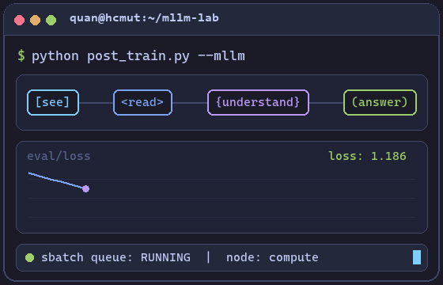

  

`[edu]` 3rd-year Computer Science Honors Student @ **HCMUT** (VNU-HCM)  
`[ai]` Interested in **Deep Learning**, **Applied AI**, and **MLLMs**  
`[mllm]` Teaching models to `[see]`, `<read>`, `{understand}`, and `(answer)` in specific domains  
`[ops]` Post-training models and patiently waiting for `sbatch` jobs in the queue  
`[chat]` Always down to chat about papers, MLLMs, and research ideas  
`[mail]` Reach me at [quan.nguyenkhmt@hcmut.edu.vn](mailto:quan.nguyenkhmt@hcmut.edu.vn)

 

